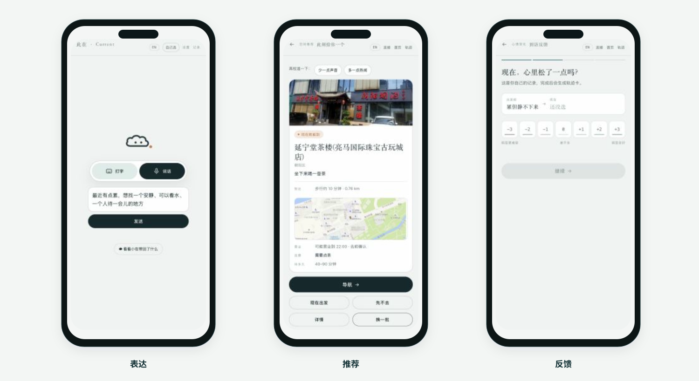
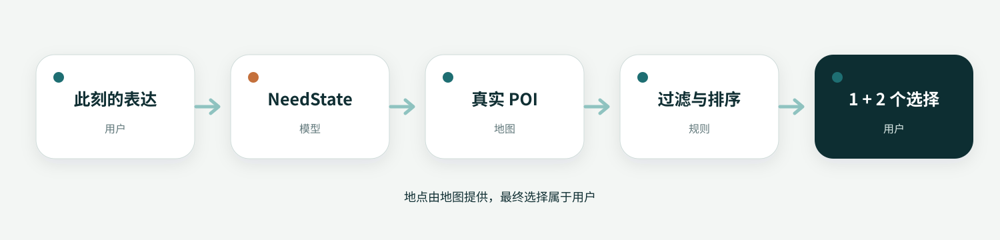
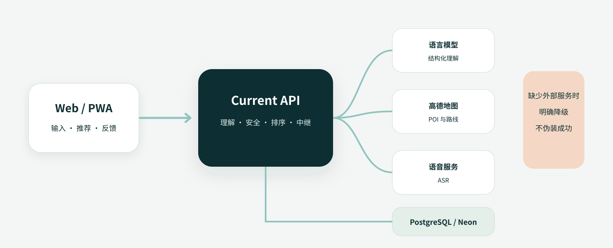
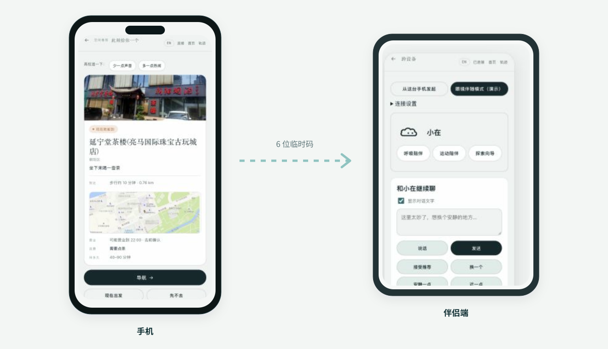

# 此在 Current

**English** · [中文](README.zh-CN.md)

<div align="center">
  
  <p><strong>When you can't quite put it into words, find a place that fits how you feel.</strong></p>
  <p>
    <a href="https://ssai-current.vercel.app/"><strong>Try it live</strong></a>
    · <a href="#the-product">The product</a>
    · <a href="#getting-started">Getting started</a>
    · <a href="docs/SPOTLIGHT_SUBMISSION.md">Competition submission (Chinese)</a>
  </p>
</div>

Sometimes you feel restless or tired, or simply don't want to go straight home—but you can't quite say where you want to go.

**此在 Current** starts there. It first interprets how you're feeling, then considers distance, opening hours, budget, and environmental preferences to suggest real places you can visit now. You can correct its understanding, ask for another option, and share whether the visit helped afterward.

The current prototype supports text and voice input, place recommendations, map handoff, visit feedback, private moments, and cross-device continuity. It is still a prototype: real-world place samples, mobile network compatibility, and smart-glasses integration need further validation.

<!--
VIDEO SLOT · Once the video is ready, uncomment the following two lines and replace the cover and URL.
## 60-second demo
[](VIDEO_URL)
-->

## Why we built it

At first, we thought the problem was simply that place recommendations weren't accurate enough. We began by organizing places, tags, and matching rules. But we soon realized that the harder part often comes before search: people don't know whether to type "park," "bookshop," or "café." They only know they don't want to stay where they are.

So the entry point shifted from "What are you looking for?" to "How are you right now?" We added real map data because even the most appealing suggestion is useless if the place doesn't exist, is closed, or is too far away. We then added corrections and visit feedback because the system can misunderstand someone on its first try. Users should be able to say "That's not what I meant," "Somewhere closer," or "I just want to exercise today."

We encountered these problems ourselves. In one verification, the system confused a chain's wrong branch with a location near Gulou; in another test, several results weren't near Liangmaqiao at all. Since then, a convincing model response has not counted as a successful recommendation. A model can interpret a person's needs, but it cannot establish that a place exists in place of map data, or decide where someone should go.

## The product

The three views below come from the current live version, rather than concept mockups. The existing product images and diagrams use Chinese labels.



A typical journey looks like this:

1. Say how you feel right now, or type it.
2. Xiaozai, the companion, reflects its understanding back to you; you can correct it at any time.
3. The system offers one main recommendation and two alternatives with different approaches, drawn from map candidates.
4. Open your map to head out, or ask for somewhere closer or quieter.
5. Brief feedback after a visit influences future recommendations only when the evidence requirements are met.

Try it live: <https://ssai-current.vercel.app/>

> Voice availability depends on your browser, network, and cloud-service configuration. If it doesn't work, switch to text. The current live version is primarily designed for mobile browsers.

## How recommendations work



The language model does not invent places or determine the final ranking.

- **The model interprets what you say:** natural language becomes a constrained `NeedState`, including needs, energy, social preferences, environment, budget, maximum travel distance, and explicitly requested activities.
- **Maps supply the places:** points of interest (POIs), coordinates, routes, and administrative city information come from map services such as Amap. Manually verified places have separate source labels.
- **Rules rank the candidates:** hard constraints such as distance, opening hours, and budget are applied first. Remaining candidates are scored for needs, energy, travel, social preferences, and budget.
- **Users can override an inference:** an explicitly requested activity takes priority. "I want to go to a gym" should not become "A park would be better for you."

The current baseline score is:

```text
45% needs match + 20% energy fit + 15% travel fit
+ 10% social fit + 10% budget fit
```

These weights are a baseline that can be inspected, reproduced, and compared—not a permanent answer. We focus on where a recommendation went wrong: interpretation, map discovery, ranking, or inaccurate place information.

## What maps don't know

Maps are good at telling you what a place is and how far away it is. They rarely tell you whether a space is suitable for being alone, spending time with little energy, or simply taking a quiet breath. That's why we began building a database of how people experience spaces.

One person's words do not become a public conclusion automatically. Place identity, coordinates, opening information, human-written descriptions, and visit feedback each retain their sources and verification timestamps. A newly discovered POI does not automatically receive a convincing-sounding story about the space.

### One visit doesn't change everyone's recommendations

A single self-reported experience does not establish that a place works for everyone. Only feedback that passes checks for place coordinates, time on site, and server-side evidence can enter a space profile. A place must accumulate at least five qualifying reports before its feedback affects ranking, and adjustments to tag weights are capped at 45%.

When there isn't enough evidence, the interface says the sample is still small instead of presenting an apparently reliable average.

Users can also contribute experiences that maps don't capture. Public text enters a moderation queue; photos and private notes stay on the device by default, and contributors receive a withdrawal token. The current implementation supports reviewable, retractable contributions rather than public emotional profiles or nearby-person matching.

## Current system



| Layer | Current implementation |
| --- | --- |
| Web client | Vanilla JavaScript, hash router, PWA; input, recommendations, navigation, feedback, and records |
| API | FastAPI, Pydantic; strict input validation, rate limits, logging, and fallback responses |
| Emotional interpretation | OpenAI-compatible LLM, with local rules as a fallback |
| Geography | Amap Web Service; POIs, geocoding, routes, and map links |
| Recommendations | Deterministic Python ranking; hard filters, weighting, diversity, and travel corrections |
| Data | PostgreSQL / Neon; structured decisions, visit outcomes, space profiles, and cross-device events |
| Voice | Browser Speech API / Tencent real-time ASR; falls back to text input on failure |

Fallbacks make service limitations visible. Without a map key, the system explicitly uses manually curated candidates. If the database is unavailable, it doesn't claim synchronization succeeded. If voice fails, it explains how to continue.

## Phone first, glasses as an optional companion



When we first discussed smart glasses, it was tempting to imagine a new interface that could do everything. Mapping the actual journey clarified the division: private expression, permissions, and final confirmation belong on the phone; directions, progress, and a brief word of companionship after departure may fit glasses or another lightweight device.

The current code lets a phone create a temporary six-digit code. A companion client can join to receive structured events for interpretation, recommendations, departure, and feedback, and send back limited requests such as "Another option," "Closer," or "Quieter." Sessions expire after 12 hours. The companion cannot directly change recommendation results on the user's behalf.

This is still a web-based collaboration prototype. We have not integrated a real smart-glasses SDK or implemented AR navigation, visual recognition, or continuous environmental capture. The next question is whether it actually reduces looking down at a phone and interruptions.

## What works today

| Available to validate | Not yet achieved |
| --- | --- |
| Chinese and English text input | Integration with a real smart-glasses SDK |
| Browser and Tencent voice paths | AR navigation and visual recognition on glasses |
| Interpretation of feelings, needs, and constraints | Large-scale real-world visit data |
| Real POI search and search within a specified city | Manual place verification across all cities |
| Explainable ranking, corrections, and route handoff | Equally stable voice across all regions and networks |
| Visit feedback, private moments, and share cards | Evidence of medical or psychological effectiveness |
| Basic user contributions, moderation, and withdrawal flow | |
| Six-digit-code cross-device continuity prototype | |

A companion webpage demonstrates cross-device continuity, not a completed glasses integration. A self-reported change after one visit does not establish a therapeutic effect.

## Privacy and safety

Feelings and location are personal, so we limit what the system receives from the start.

- Raw audio is not stored, and the original text of personal disclosures is not written to the server database.
- Continuous location trails are not recorded; manually entered addresses are used only for the current request.
- Geofence checks run locally in the browser. The server receives only evidence levels and visit-duration results.
- The system does not diagnose, create personality labels, or use negative colors to penalize emotional changes.
- Expressions of severe distress enter a safety flow before model recommendations. Place suggestions do not replace human support.
- User-contributed content enters moderation, with a withdrawal token provided to the contributor.

## Tests

The most recent full validation reported in the project passed **217 backend tests and 70 frontend policy tests, 287 in total**.

```bash
.venv/bin/pytest -q
node --test tests/*.test.js
node --check current-client.js
node scripts/extract_place_data.mjs
```

These tests cover emotional interpretation, explicit activities, maps and coordinates, recommendation ranking, safety boundaries, privacy, visit evidence, cross-device behavior, voice, and PWA state. Automated tests do not replace acceptance testing on real iPhone and Android devices, in WeChat's embedded browser, or across mainland China, Hong Kong, and overseas networks.

## Getting started

### 1. Install

```bash
git clone https://github.com/Juliejue/ssai-current.git
cd ssai-current

python3 -m venv .venv
.venv/bin/pip install -r requirements.txt pytest
cp .env.example .env
```

### 2. Start

```bash
.venv/bin/uvicorn backend_app.main:app --port 8001
python3 -m http.server 8000
```

Open <http://127.0.0.1:8000/此在-current-原型.html>.

### 3. Optional services

| Environment variables | Purpose | If unavailable |
| --- | --- | --- |
| `LLM_API_KEY` / `LLM_BASE_URL` / `LLM_MODEL` | Structured interpretation of natural language | Falls back to local rules |
| `AMAP_WEB_SERVICE_KEY` | POIs, geocoding, and routes | Uses manually curated candidates and labels estimates |
| `TENCENT_SECRET_ID` / `TENCENT_SECRET_KEY` / `ASR_APP_ID` | Tencent real-time voice recognition | Uses browser voice recognition or text |
| `DATABASE_URL` | Persistence and cross-instance relay | Retains the single-instance experience |
| `ALLOWED_ORIGINS` | Browser cross-origin allowlist | Allows only default local addresses |

Keep keys in server-side environment variables and do not commit them. See [External service setup (Chinese)](开通清单-外部服务.md) for full configuration.

## Repository structure

```text
此在-current-原型.html       Web prototype and page routing
current-client.js            AI, voice, maps, and journey state
current-moments.js / css     Private moments, contributions, and visual state
xiaozai-voice.js             Companion speech playback controls
reach-policy.js              Proactive outreach and do-not-disturb policies

backend_app/
  interpretation.py          Structured interpretation, rule fallbacks, safety entry
  discovery.py               Nearby and specified-city place discovery
  recommender.py             Deterministic ranking and route corrections
  map_provider.py            POIs, geocoding, routes, and coordinate conversion
  presence.py                On-site evidence validation
  space_profiles.py          Space profiles
  community.py               User contributions, moderation, and withdrawal
  relay.py                   Cross-device event relay

tests/                       Frontend/backend, safety, privacy, and map regressions
scripts/                     Data migration, place verification, and moderation
brand/                       Brand and Xiaozai character assets
CurrentHRVDemo/              Swift / HealthKit exploratory experiments
```

## What's next

Following the submission, we want to investigate four specific questions:

1. Can the same description of a person's state produce equally credible candidates in different cities?
2. When users don't open a recommendation, is the problem interpretation, the place, distance, or how it was presented?
3. Do smart glasses reduce looking down at a phone, or simply add another screen to maintain?
4. Can a small amount of real visit data improve recommendations without compromising privacy or presenting individual experiences as general rules?

Full competition answers, the Shenzhen-stage plan, and resource needs are in the [Spotlight submission (Chinese)](docs/SPOTLIGHT_SUBMISSION.md). This README focuses on the product, code, and what can currently be verified.

## Team

- **Estelle Ma** — Team Lead
- **Jue Chen, Camille Yu, PuffyFish Yang** — Core members

The team's work spans product, user research, AI agents, recommendation and geographic engineering, visual design, smart-hardware exploration, testing, and deployment.

GitHub Issues are welcome for reproducible bugs, place corrections, mobile compatibility reports, and suggestions about GIS, recommendations, device integration, and privacy. Please do not include original personal disclosures, precise home addresses, continuous location data, raw audio, or API keys in issues.

## License

This repository is currently used for competition review, product validation, and team collaboration. No open-source license has been granted. Except where third-party materials state otherwise, all rights to the code, design, and brand assets are reserved.

---

<div align="center">
  <sub>此在 Current · Live more fully in the real world</sub>
</div>
